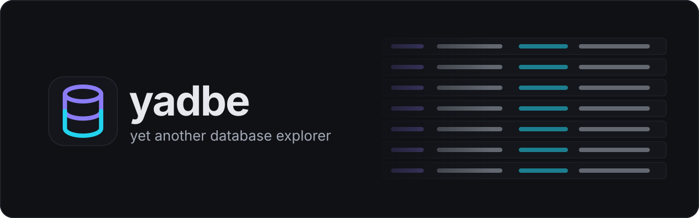
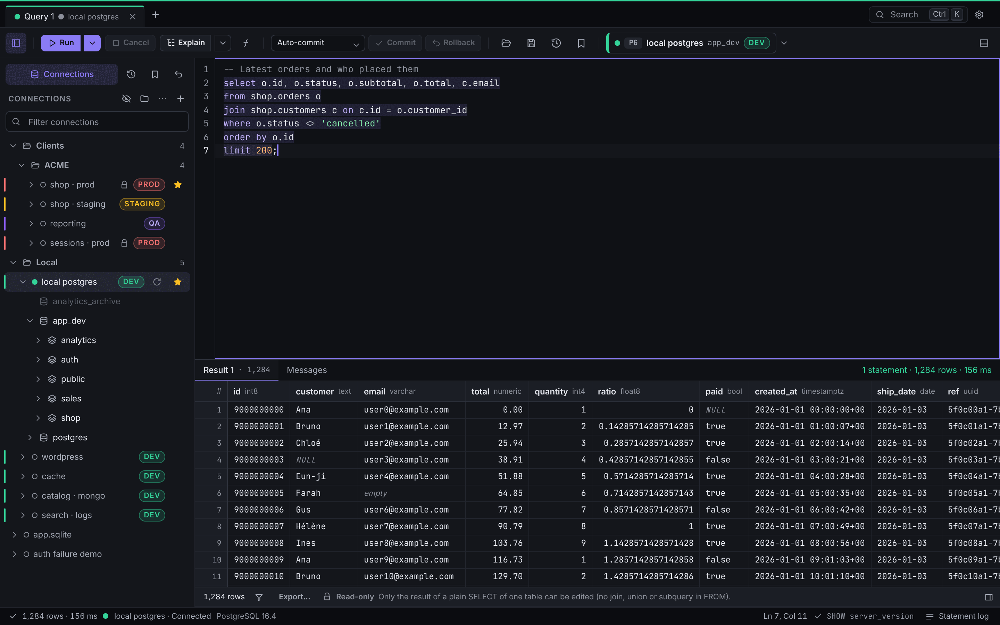
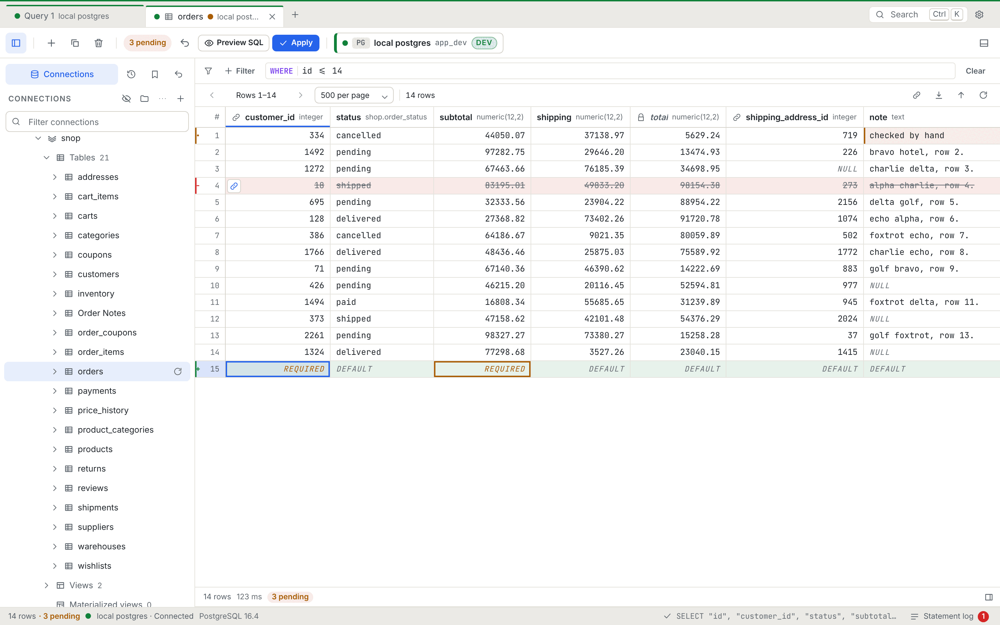
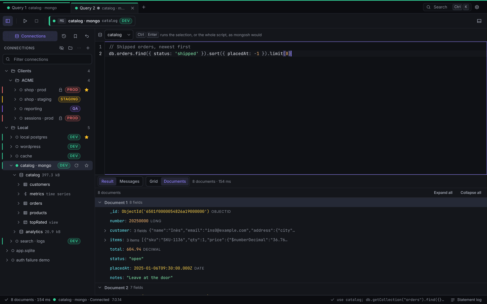
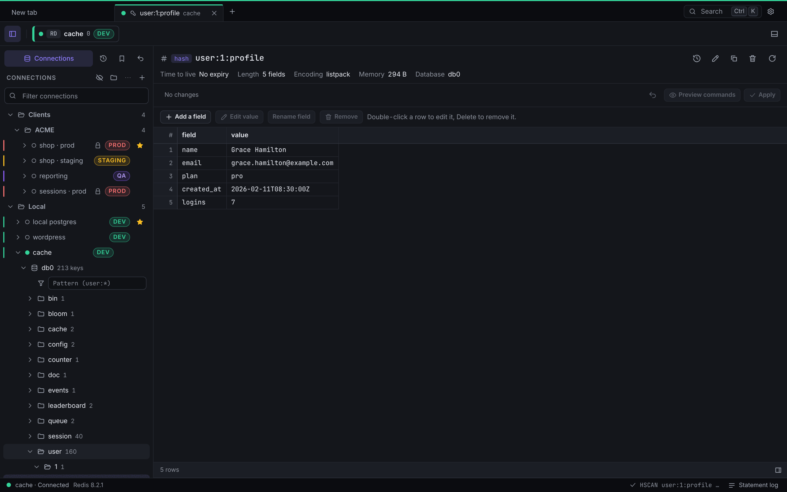
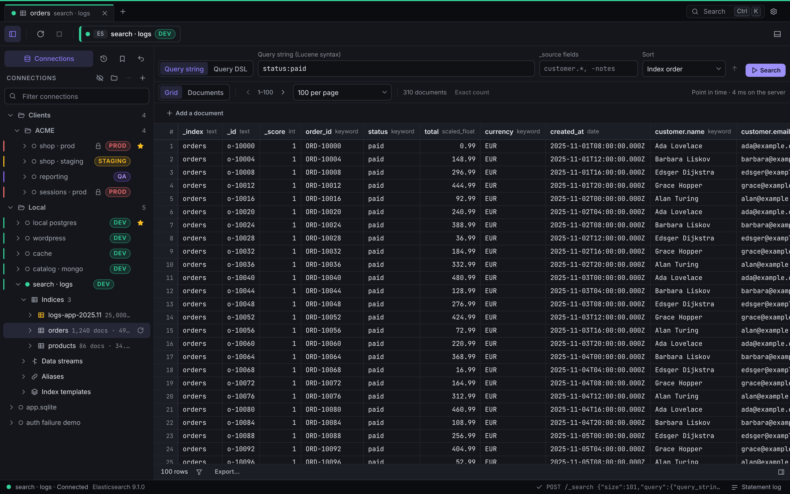

<p align="center">
  <picture>
    <source media="(prefers-color-scheme: dark)" srcset="docs/assets/banner-dark.svg">
    <source media="(prefers-color-scheme: light)" srcset="docs/assets/banner-light.svg">
    
  </picture>
</p>

**yadbe** is yet another database explorer: a fast, local, cross-platform client for SQL, document, key-value and search databases, built with Tauri and Rust, with safety on every change it makes.



<table>
  <tr>
    <td></td>
    <td></td>
  </tr>
  <tr>
    <td></td>
    <td></td>
  </tr>
</table>

## Features

- **Many engines**: PostgreSQL, SQL Server, MySQL / MariaDB and SQLite; MongoDB; Redis and Valkey; Elasticsearch and OpenSearch.
- **Connections** with groups, favorites and environment tags (a prod connection tints the window and every confirmation), pasted connection strings (URL, ADO.NET, JDBC), TLS with client certificates, SSH tunnels with jump hosts, and import from Azure Data Studio, DBeaver, SSMS, pgpass and pg_service.
- **Schema explorer** that stays fast on large schemas: lazy, virtualized, filterable, with Script as and object properties, DDL, rename and drop.
- **SQL editor** on CodeMirror: schema-aware autocomplete, hover cards and go to definition, parameters, formatter, snippets, query plans, auto-commit or manual transactions, and a guard on dangerous statements.
- **Results streamed into a virtualized grid**, with sort, filter, aggregates over a selection, a cell viewer for JSON, XML and binary, and copy as TSV, CSV, JSON, Markdown or INSERT.
- **Safe data editing**: pending changes shown in the grid, a SQL preview, one transaction where every `UPDATE` and `DELETE` must touch exactly one row, conflict detection, and editable query results.
- **Change journal with revert**: every applied change is recorded and can be undone, for tables, keys, documents and search documents.
- **Foreign key navigation**: peek, jump, referencing rows and a lookup editor.
- **MongoDB**: collection tabs with filter, projection and sort, a mongosh script editor with confirmation of dangerous operations, a documents tree view, and document edits.
- **Redis and Valkey**: a key browser grouped by delimiter, a viewer per key type, a redis-cli style console and key edits.
- **Elasticsearch and OpenSearch**: an index browser, query string or Query DSL, a console in Kibana syntax (hits, aggregations, ES|QL and SQL tables), and one-document edits.
- **Import and export**: a data import wizard with column mapping and a dry run; export to CSV, JSON, JSON Lines, SQL, Markdown or Excel, streamed to disk.
- **Operations**: an activity monitor (sessions, locks, who blocks whom, kill) and an EF Core migrations timeline.
- **Command palette** (`Ctrl/⌘ K`), saved queries, history with full-text search, a statement log of everything yadbe runs on its own, Graphite (dark) and Paper (light) themes, English and French.
- **Local and private**: no account, no telemetry; secrets stay in the OS keychain and read-only connections are enforced by the backend.

The requirements are in [`docs/SPEC.md`](docs/SPEC.md) and the task breakdown in [`docs/PLAN.md`](docs/PLAN.md).

## Install

Packaged releases are not published yet. Build from source in the meantime.

## Build from source

Prerequisites: [Rust](https://rustup.rs) 1.93+, [Node.js](https://nodejs.org) 22+, [pnpm](https://pnpm.io) 10 (`corepack enable`), and the [Tauri system dependencies](https://v2.tauri.app/start/prerequisites/) for your OS (WebView2 on Windows, Xcode Command Line Tools on macOS, WebKitGTK on Linux). `mise install` sets up the toolchains.

```bash
git clone https://github.com/SimonVanMello/yadbe.git
cd yadbe
pnpm install
pnpm tauri dev                     # run in development mode
pnpm tauri build                   # installers in src-tauri/target/release/bundle/
```

`pnpm dev` runs the frontend alone in a browser on a mocked backend (http://localhost:1430), with sample data for every engine family.

The app keeps its connections, tabs and preferences in `yadbe.db` in the OS config folder; `YADBE_CONFIG_DIR=<folder>` uses another one.

## Development

```bash
pnpm check        # case check, lint, format, typecheck, unit tests
pnpm test:ui      # Playwright on the mocked backend
pnpm screenshots  # README images in docs/assets/
cd src-tauri && cargo fmt --check && cargo clippy --all-targets -- -D warnings && cargo test
```

Integration tests run against real engines started with `docker compose -f dev/compose.yml up -d`. See [`CLAUDE.md`](CLAUDE.md) for the conventions and the full command list.

## License

[GPL-3.0-or-later](LICENSE)
